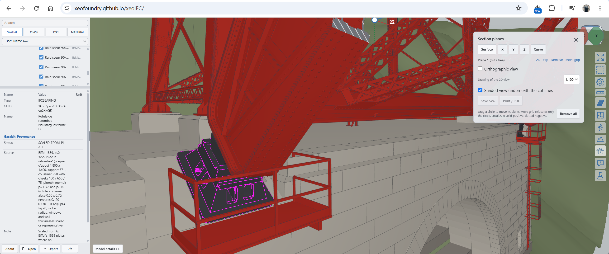
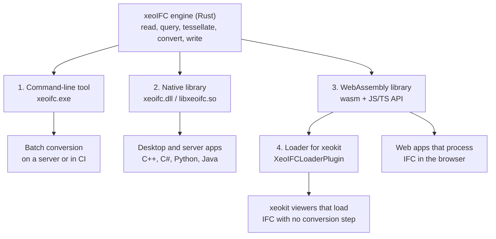
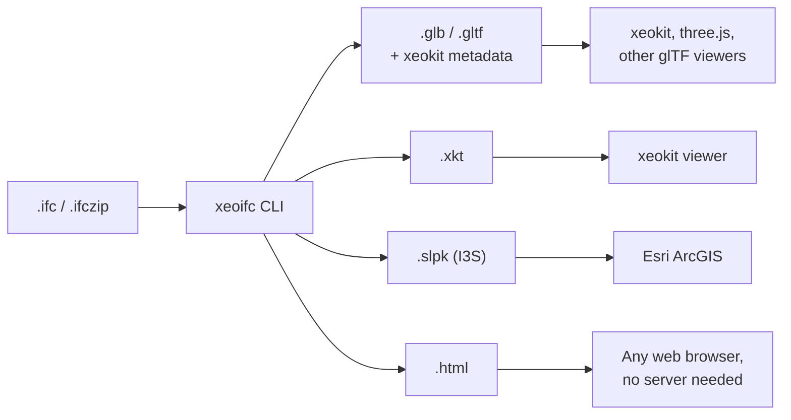
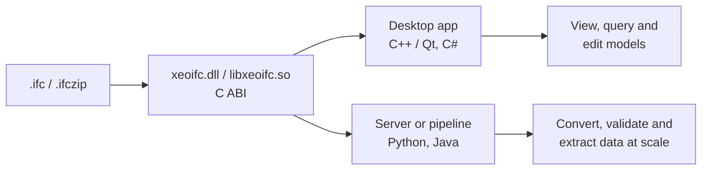
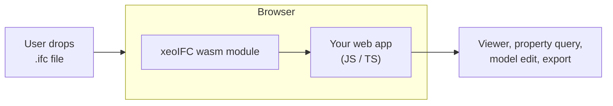
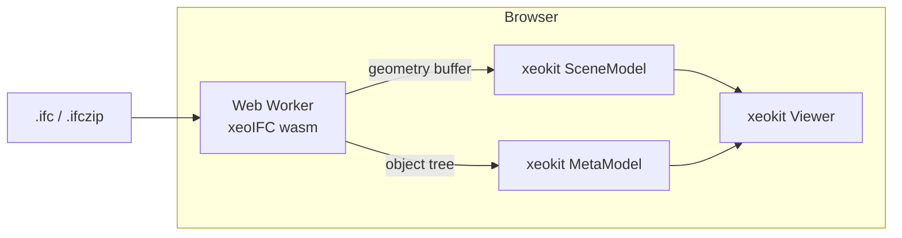
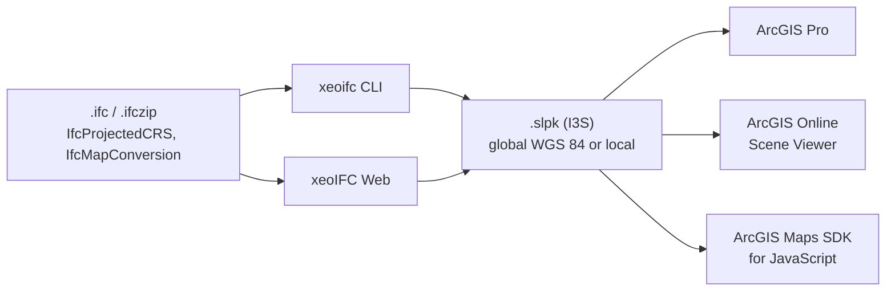

<!-- Generated file: edit the source in the dev repository. sha256:9df2202ae6efb342 -->
<h1 align="center">
  <a href="https://xeofoundry.github.io/xeoIFC/">
    <picture>
      <source media="(prefers-color-scheme: dark)" srcset="docs/showcase/readme/xeoIFC-logo-on-dark.svg">
      
    </picture>
  </a>
</h1>

<h3 align="center">The IFC toolkit for browser, desktop and server</h3>

<!--p align="center">
  IFC 2x3 to IFC 4.3<br>
  IFC to GLB, XKT, SLPK and HTML
</p-->

<p align="center">
  <a href="https://xeofoundry.github.io/xeoIFC/showcase/garabit/"></a>
</p>

<p align="center"><sub>In the picture: the Garabit viaduct. 9 IFC files in one scene, 678,768 rivets. Created with xeoIFC,
see <a href="https://xeofoundry.github.io/xeoIFC/showcase/garabit/">showcase</a>.</sub></p>

> [!TIP]
> Quick start: open the [live demo](https://xeofoundry.github.io/xeoIFC/) to try xeoIFC in your browser (powered by WebAssembly).


<!--
**[Showcase](https://xeofoundry.github.io/xeoIFC/showcase/)** · **[Downloads](https://github.com/xeofoundry/xeoIFC/releases/)** ·
**[Licence and contact](#licence-and-pricing)**
-->

xeoIFC reads, queries, tessellates, converts and writes IFC (`.ifc`, `.ifczip`; IFC 2x3 to IFC 4.3). It is one Rust
engine by [xeoFoundry](https://xeofoundry.com).

- **Proven on real projects.** 95 GB of real-world IFC: > 2.2k files converted in under 19 minutes on one
  workstation (xeoIFC 1.0.21, October 2026).
- **IFC 4.3 infrastructure.** Alignments, sectioned solids and georeferenced models, as in the
  [Viadotto Acerno bridge](https://xeofoundry.github.io/xeoIFC/?load=Viadotto-Acerno.ifczip).

<!--- **Private by design.** In the browser the files are processed locally with WebAssembly and WebGPU; nothing is
  uploaded.
-->

- **One engine, every platform.** Browser, Windows x64, Linux x64 and arm64.

xeoIFC is delivered in four forms:

1. **Command-line tool** - The successor to [cxconverter](https://github.com/Creoox/creoox-ifc2gltfcxconverter), offering better geometry quality and far more capabilities. It covers the standard IFC to glTF/GLB/XKT workflow with [xeokit](https://github.com/xeokit/xeokit-sdk) metadata, and also supports [SLPK (I3S) for Esri ArcGIS](esri/README.md) and raw IFC metadata.
2. **Native library** - `xeoifc.dll` / `libxeoifc.so` with a C ABI, for desktop and server applications in C++, C#, Python, Java, ...
3. **WebAssembly library** - wasm modules with a JavaScript/TypeScript API, for web applications.
4. **Loader for xeokit** - loads IFC directly into a xeokit viewer, without server side conversion steps.



Example use cases: [xeoIFC showcase](https://xeofoundry.github.io/xeoIFC/showcase/).

## 1. Command-line converter

The native converter turns `.ifc` and `.ifczip` files into glTF 2.0 (`.glb`, `.gltf`) with xeokit metadata, xeokit `.xkt`, Esri `.slpk` (I3S) or a self-contained `.html` viewer. It keeps the cxconverter command-line flags and `cxconverter.json` configuration shape.

```powershell
.\xeoifc.exe -i Duplex.ifc -o test\duplex.glb
```



Features, options, output files and license key: [converter/README.md](converter/README.md)

## 2. Native library

`xeoifc.dll` (`libxeoifc.so` on Linux) exposes the engine through a C ABI for desktop and server applications in C++, C#,
Python, Java and other languages.



Library details, examples and the Qt, gpui and WPF demo viewers: [Native library](native/README.md).

## 3. WebAssembly library

The WebAssembly library is the xeoIFC engine for web applications: wasm modules with JavaScript bindings and TypeScript
declarations. IFC files are processed in the browser; nothing is uploaded.



Library details, demo viewer, features and downloads: [WebAssembly library](webassembly/README.md).

## 4. Loader for xeokit (XeoIFCLoaderPlugin)

The WebAssembly library also feeds a [xeokit](https://github.com/xeokit/xeokit-sdk) viewer directly, without a conversion step:
the plugin runs xeoIFC in a Web Worker, unpacks its geometry buffer into a xeokit `SceneModel`, builds the `MetaModel` from the
object tree and queries property sets from the loaded model. It loads `.ifc` and `.ifczip` files (no upload of
any data).



Documentation and live examples:
[https://xeofoundry.github.io/xeoIFC/xeokit-direct-ifc-loading/](https://xeofoundry.github.io/xeoIFC/xeokit-direct-ifc-loading/)

The examples: a xeokit viewer that loads dropped files, and metadata from IFC for geometry from XKT.

## Esri ArcGIS export

The command-line converter and xeoIFC Web export IFC models as I3S scene layer packages (`.slpk`) for ArcGIS Pro, ArcGIS
Online and the ArcGIS Maps SDK for JavaScript. Several IFC files go into one layer, and each element keeps its IFC
attributes and property sets as fields. By default the layer is global: the vertices are transformed from the CRS the IFC
files declare into WGS 84, so the model shows in its place over world imagery and terrain. A local layer in a projected
CRS is written on request.



Referencing, coordinate systems, configuration and how to check the placement: [Esri ArcGIS export](esri/README.md).

## Authoring

> [!WARNING]
> New and experimental: IFC authoring is still under active development.

The document API creates IFC models from scratch, including geometry, materials and property sets. The command-line tool
runs authoring scripts. See [Authoring](authoring/README.md) for examples, screenshots and code.

## Licence and pricing

Everything runs without a licence key, for testing and evaluation under the
[xeoIFC Testing License](https://xeofoundry.github.io/xeoIFC/xeoIFC-Testing-License.txt). Without a key the output
carries an "Evaluation version" mark. Commercial and production use needs a licence.

<!--
| Licence | What you get |
| --- | --- |
| **Pro** | Unmarked exports from the viewers: split, merge, reduced IFC, GLB, XKT, I3S. Per seat. |
| **Server** | The command-line converter and the native library in your pipeline. Per machine. |
| **Engine (OEM)** | The WebAssembly and native engine inside your product, with priority fixes on your files. |
| **Custom build and support** | Branded viewers and checkers, with an SLA. |
-->

Contact: [contact@creoox.com](mailto:contact@creoox.com?subject=xeoIFC%20licence), ask for single-user license, server (CLI) license, or custom build and support.

### Send us your hardest file

Send up to three IFC files that your current engine struggles with. Within 48 hours you get back, privately: a
self-contained HTML viewer of each file, rendered views, and the load time and memory. No commitment.

## Architecture

One Rust engine powers the WebAssembly library, the command-line converter and the native library, with a shared document
API and geometry engine. See [Architecture](architecture/integration-map.md) for details.

## Third-party software

The xeoIFC libraries and the converter include open-source components (Rust crates under MIT, Apache-2.0,
ISC, Zlib and similar permissive licences, among them `laz` for LAZ point clouds, `wgpu`, `i_overlay`,
`earcutr` and `delaunator`), plus code derived from jcadlib and csg.js. The full list with all licence
texts ships as `THIRD-PARTY-NOTICES.txt` in every release package and with xeoIFC Web:
[THIRD-PARTY-NOTICES.txt](https://xeofoundry.github.io/xeoIFC/THIRD-PARTY-NOTICES.txt)

The xeoIFC gpui packages add `THIRD-PARTY-NOTICES-gpui.txt` for the Rust crates of that application (gpui and its
dependencies, under Apache-2.0, MIT and similar permissive licences).
